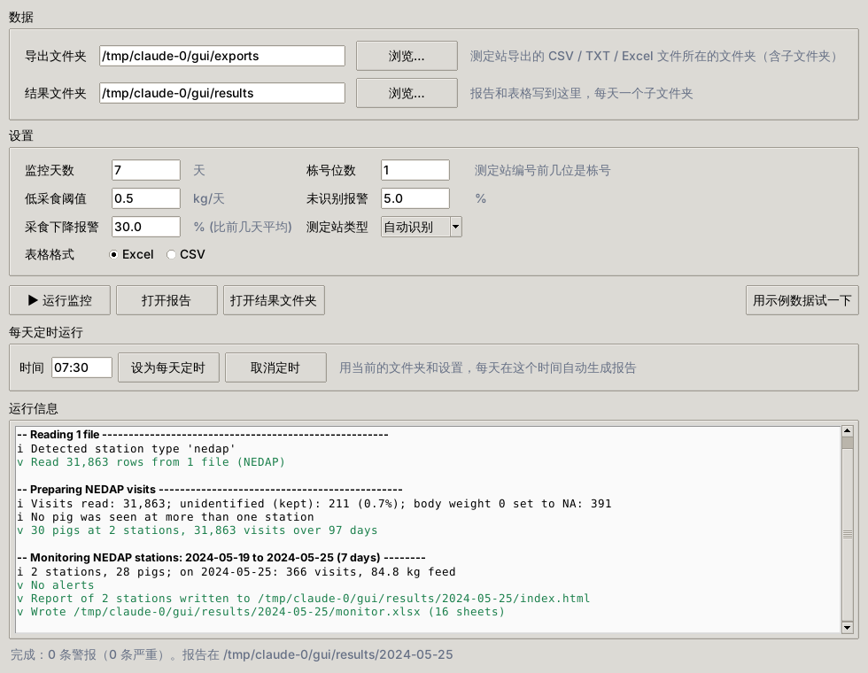

# 桌面程序

给不写代码的同事用：Windows 上不用装 Python，也不用装 R。

## 安装

1. 打开 [Releases](https://github.com/tony2015116/tidypptsdm-py/releases)，下载最新版本的 `tidypptsdm-windows.zip`（约 70 MB）。
2. 解压到一个固定的文件夹，例如 `D:\tidypptsdm`。不要放在“下载”文件夹里，以后移动会让定时任务找不到程序。
3. 双击 `tidypptsdm.exe`。可以右键“发送到 → 桌面快捷方式”。

!!! note "第一次打开"
    程序没有数字签名，Windows 可能提示“Windows 已保护你的电脑”，点“更多信息 → 仍要运行”即可。

## 使用

1. **导出文件夹**：测定站导出的 CSV、TXT 或 Excel（.xlsx）文件所在的文件夹，子文件夹里的文件也会读入。NEDAP 和 FIRE 自动识别。
2. **结果文件夹**：报告和表格写到这里，每次运行生成一个以最后一天命名的子文件夹，例如 `2024-05-25`。
3. 按需修改设置，点 **▶ 运行监控**。完成后报告自动在浏览器中打开。

没有数据时，点 **用示例数据试一下**，示例数据会写到用户目录下的 `tidypptsdm_example`。

| 设置 | 含义 | 默认 |
|---|---|---|
| 监控天数 | 报告覆盖最近几天 | 7 |
| 栋号位数 | 测定站编号的前几位是栋号，例如编号 `203` 取 1 位就是 2 栋 | 1 |
| 低采食阈值 | 猪一天的采食量低于此值（kg）算低采食 | 0.5 |
| 未识别报警 | 测定站当天未读到耳标的访问超过此百分比时报警 | 5 |
| 站采食下降报警 | 测定站当天的**头均**采食量比前几天平均低这么多（%）时报警（猪变少不会误报） | 30 |
| 个体采食骤降 | 一头猪当天的采食量比它自己前几天（最多 5 天）的平均低这么多（%）时报警；`0` = 不检查 | 50 |
| 测定站类型 | 自动识别，或指定 NEDAP / FIRE | 自动识别 |
| 表格格式 | Excel 工作簿或 CSV 文件 | Excel |
| 截止日期 | 报告的最后一天。留空 = 数据里最后一个完整的日子（见下面“报告看哪一天”）；回看历史时填，如 `2025-01-10`，报告就是这一天往前的“监控天数”天 | 空 |

设置会自动保存，下次打开还在。

运行时，“运行信息”里按五步显示进度和用时（读取数据、整理数据、计算监控、作图、写出结果），最后是**结论**：最后一天的概况、严重警报（测定站停机、猪没有访问）和警告的数量。出错时会写明原因和“怎么办”。同样的内容也写进结果文件夹里的 `tidypptsdm.log`，见[每天定时运行](schedule.md#日志)。

## 报告和警报

报告是中文的，首页先列出**今日待办**：

- **需要检查的测定站**：全天没有访问、中途停止记录（例如“从 07:50 起没有记录”）、白天长时间没有记录、未识别过多、头均采食下降；
- **需要看的猪**：没有访问（3 天以内）、低采食、采食骤降；
- **长期未访问**：超过 3 天没来的猪，多半已经死亡、淘汰或转出，请确认。

每条警报标出 **新**（今天第一次出现）或 **持续 N 天**。后面是各测定站和各栋的表格；每台测定站一页，有警报、趋势图、采食量图、猪只表（每头猪的状态和说明）、体重图和分小时图。

为了少误报，桌面程序和 Python 函数（R 版）有三点不同：

1. **测定站中途停止记录时只报一条。** 一台测定站某个时刻以后没有记录（比平时最长的间隔长得多，至少 4 小时），报“中途停止记录”一条，不再给站上的每头猪各报一条“没有访问”；这些猪在猪只表里标“站停止记录”。
2. **报告看哪一天。** 数据的最后一天如果在 22 点以前就结束了（白天导出），这一天不完整，报告看前一天，并在首页和运行信息里说明。
3. **离场猪名单。** 点 **离场猪名单…**，在打开的记事本里每行写一个耳标号（后面可以写日期和原因），保存即可。名单 `离场猪.txt` 在结果文件夹里，定时任务也读取它；名单上的猪不再报警，猪只表里标“已离场”。

Excel 工作簿的 `Alerts` 表与报告的警报相同（中文列名）。

时间：普通的导出（如 `2026/10/30 1:04`）原样使用。少数导出的时间带时区标记（如 `2025-01-24T00:34:17Z`，`Z` 表示 UTC），桌面程序自动换算成北京时间，与电脑的时区设置无关，见[读取数据](data.md#时区)。

## 每天定时运行

填好文件夹和设置后，在“每天定时运行”里填时间，点 **设为每天定时**。程序会在 Windows“任务计划程序”里建一个名为 `tidypptsdm_monitor` 的任务，每天在这个时间用当前设置生成报告，不会弹出窗口；运行日志写在结果文件夹的 `tidypptsdm.log` 里。点 **取消定时** 删除这个任务。

关闭本程序后，定时任务照常运行：它由 Windows 任务计划程序启动，不依赖这个窗口。点 **查看定时状态** 可以看到下次和上次运行的时间、上次的结果（0 表示成功）和日志的最后几行；点 **立即运行一次** 可以马上检查任务能不能正常出报告。更多说明见[每天定时运行](schedule.md)。

## 历史数据

报告总是覆盖**数据里最后一天**往前的“监控天数”天，与今天的日期无关，所以历史数据也会出结果。数据的最后一天离今天超过 1 天时，运行信息和报告首页会提示“最新数据是 N 天前的”：看历史数据时可以忽略；每天定时监控时，说明测定站的导出可能停了。
