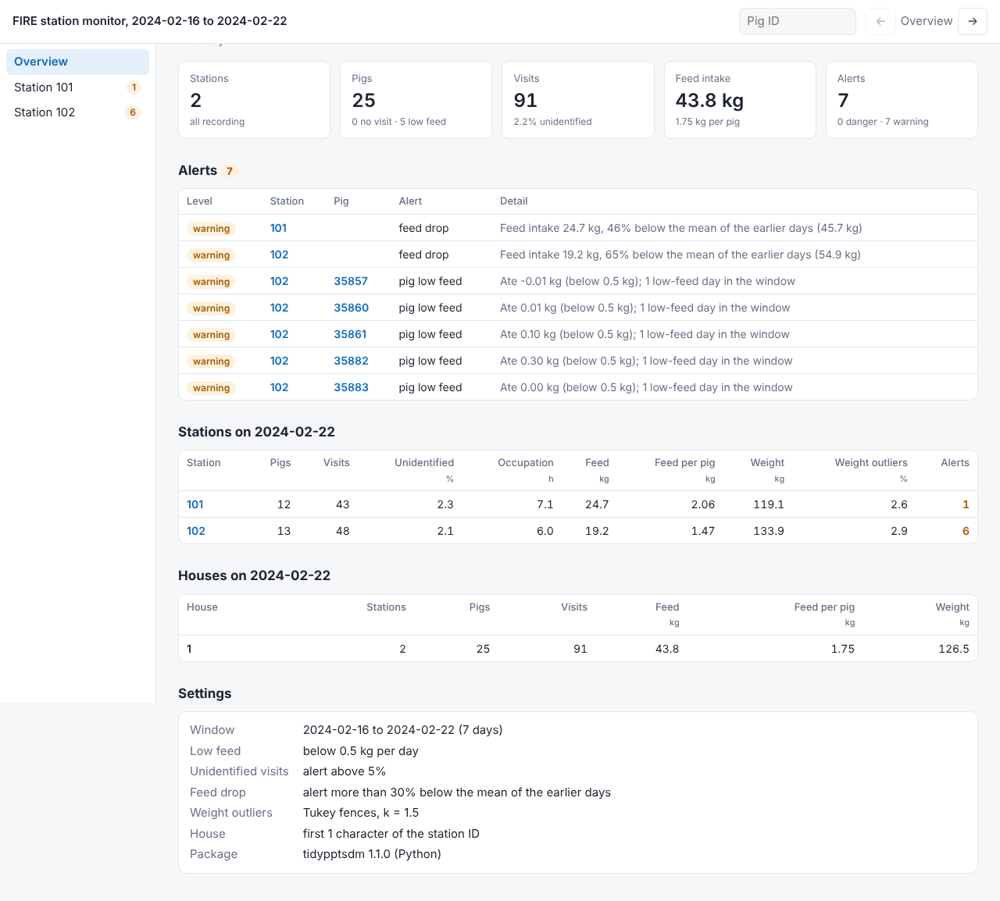

# tidypptsdm

**种猪性能测定站日常监控。** 读取 NEDAP 或 FIRE 测定站的导出文件，回答每天巡检要问的几个问题：

- 每台测定站都在正常记录吗？
- 耳标读得到吗？
- 每头猪都还在吃料吗？
- 最近几天的采食量和体重怎么变化？

结果是一份可以逐站翻页的 HTML 报告和一份带色阶的 Excel 工作簿，可以每天定时自动生成。



## 三种用法

<div class="grid cards" markdown>

- **桌面程序**：Windows 上不用装 Python，下载解压后双击 `tidypptsdm.exe`。选文件夹，点“运行监控”。[说明](app.md)
- **命令行**：`tidypptsdm run 导出文件夹 --out 结果文件夹`，适合放进任务计划或服务器。[说明](cli.md)
- **Python**：`tp.run_monitor()` 得到各张表，自己再分析。[快速入门](quickstart.md)

</div>

## 安装

=== "桌面程序（Windows）"

    从 [Releases](https://github.com/tony2015116/tidypptsdm-py/releases) 下载 `tidypptsdm-windows.zip`，解压到任意文件夹（例如 `D:\tidypptsdm`），双击 `tidypptsdm.exe`。

=== "pip"

    ```bash
    pip install tidypptsdm
    ```

    需要 Python 3.10 或更新版本。依赖只有 pandas、numpy、matplotlib 和 openpyxl。

=== "开发版"

    ```bash
    pip install "git+https://github.com/tony2015116/tidypptsdm-py"
    ```

## 与 R 版的关系

这是 R 包 [tidypptsdm](https://github.com/tony2015116/tidypptsdm) 的 Python 版本，计算方法相同，**结果逐表一致**：每次修改都会在两份示例数据上与 R 版的结果对比。数据的读取和整理移植自 [tidypptsda](https://tony2015116.github.io/tidypptsda/)。详见[与 R 版的关系](r.md)。
