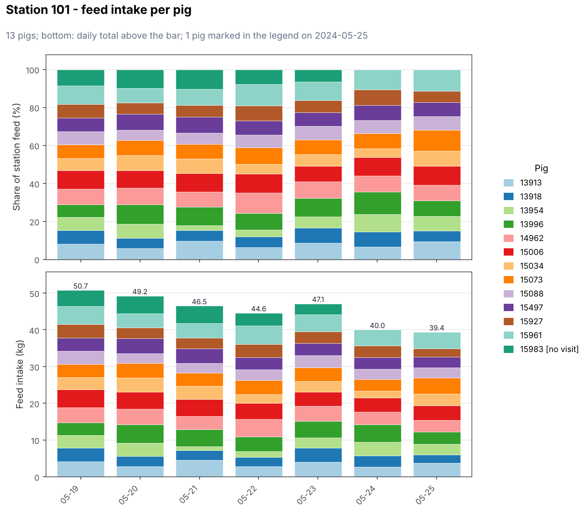
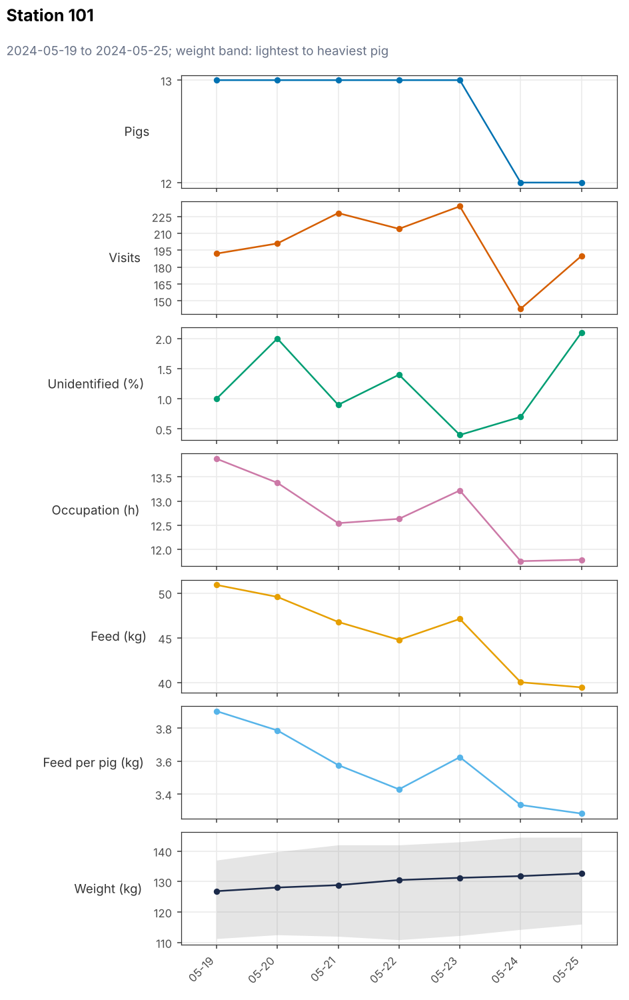
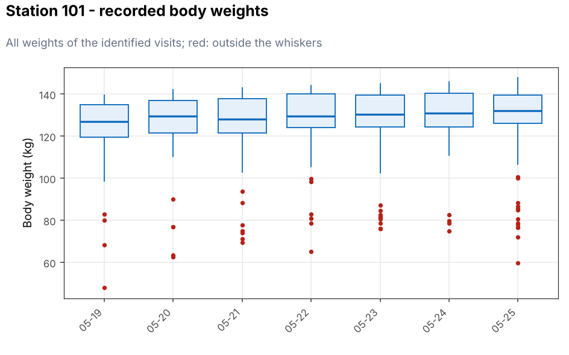
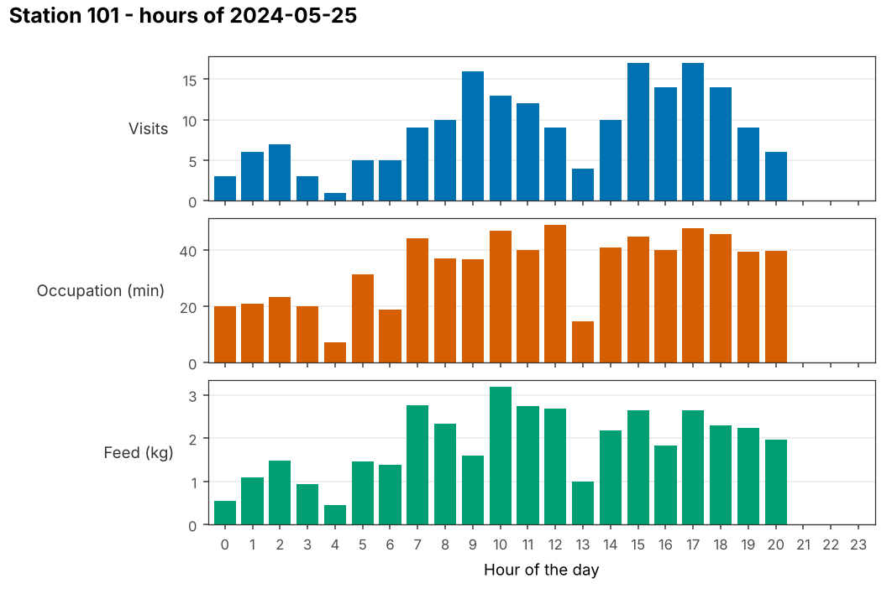

# 图与报告

## 四种图

`tp.plot_monitor(mon, type)` 每台测定站画一张图，返回 [`StationPlot`](reference.md#tidypptsdm.StationPlot) 的列表；`tp.save_monitor_plots()` 按合适的尺寸保存为 PNG 或 PDF。下面的例子里，测定站 101 的一头猪（15983）最后两天没有访问。

### 采食量：`"intake"`

每头猪一种颜色。上图是每头猪占测定站当天总采食量的比例，下图是采食量（kg），柱顶是当天总量。最后一天没有访问的猪在图例里标 `[no visit]`，采食量偏低的标 `[low feed]`。

### 趋势：`"trend"`

猪数、访问次数、未识别 %、占用时间、采食量、头均采食量和体重的逐日变化。体重线是各猪当天体重中位数的平均，灰色带是当天最轻到最重的猪。没有访问的日子标红。

### 体重：`"weight"`

每天全部体重记录的箱线图，红点在须线以外。

### 每小时：`"hours"`

最后一天每小时的访问次数、占用时间和采食量。

## HTML 报告

`tp.write_monitor_report(mon, path)` 写出 `index.html` 和 `img/`。第一页是总览：最后一天的测定站数、猪数、访问次数、采食量、警报，以及所有测定站和栋的表格；后面每台测定站一页：警报、趋势图、采食图、猪只表、体重图和分小时图。

- 方向键（或 Page Up / Page Down、Home、End）翻页；
- 搜索框输入耳标号，跳到这头猪所在的测定站并高亮；
- 打印（例如另存为 PDF）会打印所有页；
- 文件夹可以整体拷贝或压缩，离线打开。

报告页面与 R 版完全相同。
